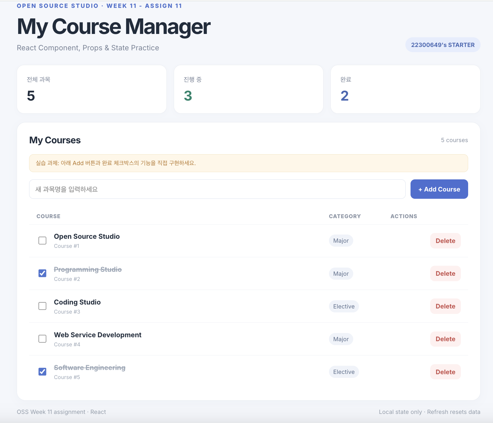

# 22300649's assignment11
**2026OSS-week11 assignment**

**Writer : 22300649 전경호**

## Project Information

**Project**

- 위 프로젝트는, Course Manager로서, 과목을 추가하고 완료표시를 눌러 확인하는, 일종의 Todo CRUD 웹사이트이다.

- 위 웹사이트에서 과목을 Create, Read, Update, Delete할 수 있다. 

- 원본 URL : https://github.com/2026-2-OSS/week11_sample_project.git

## Installation

**설치, 실행 방법**

- Sample Project: 강의에서 제공한 GitHub Repository
- GitHub Classroom Repository에서 작업
- npm install → npm run dev
- 기존 과목 목록 조회 및 삭제 기능 확인
- README.md와 package.json을 통해 프로젝트 구조 및 실행 방법 확인

**실행 화면**

## Source Code Exploration

**주요 파일**

- App.jsx
- CourseItem.jsx
- CourseList.jsx
  
**Component와 Props 관계**
- App.jsx - CourseList를 불러오고, 메인 화면 담당
- CourseList.jsx - 데이터를 소유. handleDelete,Toggle 함수 보유
- CourseItem으로 course,onDelete, onToggle을 props로 내려줌.
  
**useState 및 Event 분석, 주요 코드 2개 설명**
- course : 과목 목록, 바뀌면 다시 렌더링됨
- newName : 입력창 값
  
- onChange : 입력창 글자 변경
- onSubmit : Add버튼 클릭
- onChange : 체크박스
- onClicck : Delete버튼
  
## Customizing
**수정한 데이터, 텍스트, 스타일 및 파일명**

- 수정 : App.jsx의 topline 텍스트 변경, tag 텍스트 변경, 웹사이트의 진행중과 완료 카드의 위치를 변경, footer 일부 수정
  
## Feature Extension

**구현한 기능**
  
1. handleAdd() 구현 : 빈 입력 검사, 새 과목 객체 생성, setCourses 호출, 입력창 초기화
2. handleToggle() 구현 : map과 spread(...)를 사용하여 해당 id의 completed를 반전

**동작 결과**

- 체크박스와 과목명 입력 후 추가 기능 구현 완료
  
## Deployment

https://2026-oss-assign11-kappa.vercel.app/

## Weekly Review
**새롭게 배운 내용 3가지**
1. useState의 주요 기능
2. jsx문서의 기초 문법 내용, class처럼 전달하는 방식
3. jsx array 문법(map, spread 등)

## 어려웠던 점과 해결 방법

- Array에 대한 문법 지식이 부족해, 코드를 완성함에 있어 계속해서 값을 찾을 수 없다는 오류가 나옴.
- AI 반복학습과 수업 자료 공부로, 천천히 코드 오타를 지워나가며 해결
  
## AI Usage

- 코드를 작성함에 있어, 문법적인 오류나 타입 오류가 발생할 때, 오류 코드를 전달한 뒤, 내가 실수한 문법에 대해 고치는 것 대신 학습 자료를 전달하라고 요청 뒤 자료로 공부하며 해결

- Array에 넘어오면서, 이해해야 하는 난이도가 급상승했음을 느낌. 공부에 소홀하지 않아야겠다고 다짐.
  
